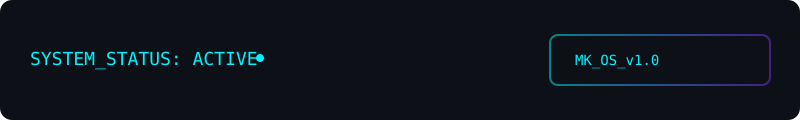

# ⚡ MICHAEL KAGE

### Systems Architect · Software Engineer · Independent Builder

I design and build software systems that prioritize deterministic behavior, data integrity, security, and operational reliability.

My work spans simulation engineering, local-first financial infrastructure, autonomous media pipelines, secure transactional platforms, and distributed monitoring.

> **Engineering philosophy:** Build systems that preserve their history, explain their state, and behave predictably under pressure.

---

## 🌌 THE SOVEREIGN SOFTWARE STACK

An interconnected portfolio exploring different layers of software engineering, from deterministic simulation and financial domain models to secure applications and automated infrastructure.

### 01 · 🧬 Life Itself
**Simulated Reality Engine · C++20 · Python**

An open-world life simulation project focused on autonomous agents, persistent memories, social dynamics, and deterministic world evolution.

- Deterministic simulation ticks, scheduling, and world coordination.
- NPC memory decay, witness-specific memories, and rumor propagation.
- Social beliefs, trust, relationships, and personality-driven interpretation.
- Evidence-driven justice and institutional decision models.
- Canonical snapshots, replay-safe persistence, and composite world checkpoints.
- Portable C++20 core with Python reference implementations.

*Status: Simulation core in progress. Unreal Engine presentation and integration are not yet implemented.*

[Repository →](https://github.com/michaelkage/Life-Itself)

### 02 · 🤖 Autonomous Media Network (AMN)
**Content Processing Pipeline · Python**

A modular pipeline for media ingestion, quality checks, perceptual duplicate detection, watermarking, and publishing.

- Supported-source ingestion, currently including Reddit.
- Pillow-based image processing and watermarking.
- 64-bit Difference Hashing (dHash) for perceptual duplicate detection.
- Engagement thresholds and sidecar metadata validation.
- Atomic, idempotent pipeline operations.
- SHA-256 verified manifests and GitHub Actions automation.
- Optional Bluesky publishing integration.

[Repository →](https://github.com/michaelkage/autonomous-media-network)

### 03 · 💸 OmniPocket
**Local-First Financial Infrastructure · React · TypeScript · Supabase**

A multi-currency wealth tracker built around financial domain state, transaction provenance, reconciliation, and resilient synchronization.

- Multi-currency accounts, transfers, and FX handling.
- Historical wealth snapshots and cached/live exchange rates.
- Local CSV/XLSX statement import and receipt OCR.
- Offline bank-sync queueing and local-first application behavior.
- Supabase-backed provider data, webhook persistence, and reconciliation.
- Duplicate fingerprints, transaction provenance, and operational diagnostics.
- PWA architecture and versioned local-state migration.

*Architecture note: the bootstrap persistence layer uses localStorage; the hardened bank synchronization boundary uses Supabase.*

[Repository →](https://github.com/michaelkage/OmniPocket)

### 04 · 🔒 Campus Plug (CP-67 MATRIX)
**Student P2P Marketplace · React · Vite · Supabase · PostgreSQL**

A university-focused marketplace with identity controls, server-authoritative transaction workflows, and automated escrow state transitions.

- University email-domain gating.
- FingerprintJS device identification and WebAuthn passkeys.
- EXIF metadata analysis and GPS boundary checks.
- Seven-state escrow workflow and QR-based release verification.
- PostgreSQL-enforced transactional rules and Supabase Edge Functions.
- Realtime marketplace activity, study pools, and gig workflows.
- PWA offline support and automated security testing.

[Repository →](https://github.com/michaelkage/campus-plug67)

### 05 · 🛰️ UNILAG Watcher
**Change Detection Infrastructure · Node.js · GitHub Actions**

A lightweight monitor for public University of Lagos feeds. It detects both newly published posts and meaningful edits to existing posts.

- Zero runtime dependencies.
- RSS ingestion and WordPress post-ID tracking.
- SHA-256 fingerprints over tag-stripped content.
- New-post and modified-post detection.
- Git-backed persistent state.
- Telegram alerts with retry-safe state advancement.
- Scheduled GitHub Actions execution every 30 minutes.

[Repository →](https://github.com/michaelkage/unilag-watcher)

---

## 🧠 ENGINEERING TOOLKIT

| Domain | Technologies |
|---|---|
| Systems programming | C++20, CMake |
| Runtime & backend | Node.js, Python 3.10+, TypeScript |
| Frontend | React 18, Vite, Tailwind CSS |
| Data & persistence | PostgreSQL, Supabase, localStorage |
| Application architecture | Local-first, PWA, domain-driven modeling |
| Security | WebAuthn, passkeys, FingerprintJS, EXIF validation |
| Automation & vision | GitHub Actions, Pillow, dHash, SHA-256 |
| Infrastructure | CI/CD, REST APIs, Edge Functions, pg_cron |

---

## ⚙️ ENGINEERING PRINCIPLES

- **Determinism:** Prefer reproducible execution and explicit state transitions.
- **Data integrity:** Preserve transaction history and enforce invariants at authoritative boundaries.
- **Security by architecture:** Treat identity, authorization, and sensitive state changes as system responsibilities.
- **Resilience:** Design useful behavior for unreliable networks and partial failures.
- **Observability:** Make system state, diagnostics, and failure paths inspectable.
- **Modularity:** Use explicit contracts and independently testable components.

---

## 📡 ENGINEERING ACTIVITY

I document implementation progress, experiments, architectural decisions, and technical milestones in my development journal.

[Daily-Log →](https://github.com/michaelkage/Daily-Log) · [All repositories →](https://github.com/michaelkage?tab=repositories)

---

## 🐍 CONTRIBUTION ACTIVITY

  

---

## 🌐 CONNECT

- **GitHub:** [github.com/michaelkage](https://github.com/michaelkage)
- **Portfolio gateway:** [michaelkage.github.io](https://michaelkage.github.io)

---

  <i>Engineering systems that are deterministic by design, resilient by architecture, and useful in the real world.</i>

